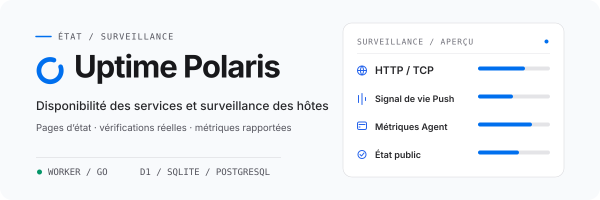

<h1 align="center">
  <picture>
    <source media="(prefers-color-scheme: dark)" srcset="assets/readme/overview-fr-FR-dark.svg">
    <source media="(prefers-color-scheme: light)" srcset="assets/readme/overview-fr-FR-light.svg">
    
  </picture>
</h1>

<p align="center"><strong>Vérifications HTTP/TCP, signaux de vie Push, métriques des hôtes</strong><br>Sur Cloudflare Worker ou sur un serveur Go auto-hébergé.</p>

Stockage : D1 ou PostgreSQL pour Worker ; SQLite ou PostgreSQL pour Go. [Démarrer avec Go](backends/go/README.md).

<p align="center">
  <a href="README.md">English</a> · <a href="README-zh-CN.md">简体中文</a> · <a href="README-zh-TW.md">繁體中文（台灣）</a> · <a href="README-zh-HK.md">繁體中文（香港）</a> · <a href="README-ja-JP.md">日本語</a> · <a href="README-ko-KR.md">한국어</a> · <strong>Français</strong> · <a href="README-pt-BR.md">Português (Brasil)</a> · <a href="README-ru-RU.md">Русский</a>
</p>

<p align="center">
  <a href="https://developers.cloudflare.com/workers/"></a>
  <a href="backends/go/README.md"></a>
  <a href="frontend/README.md"></a>
  <a href="https://github.com/XingLingQAQ/polaris-agent"></a>
  <a href="docs/configuration.md"></a>
</p>

<p align="center">
  <a href="#démarrage-rapide">Démarrage rapide</a> · <a href="#déploiement-sur-cloudflare">Déploiement</a> · <a href="#deploy-go">Déploiement Go</a> · <a href="#surveillance-des-hôtes">Agent</a> · <a href="#documentation">Documentation</a>
</p>

Uptime Polaris réunit une page d'état publique, une console d'administration et la surveillance planifiée dans une seule application. Il exécute des vérifications HTTP/TCP, reçoit les signaux de vie Push, collecte les métriques des hôtes avec `polaris-agent` et envoie une notification quand un moniteur change d'état.

## Choisir un backend

Choisissez un seul backend par déploiement. Go fonctionne sans compte Cloudflare, D1 ni R2.

Stockage : Worker utilise D1 ou PostgreSQL et stocke les thèmes dans R2. Go utilise SQLite ou PostgreSQL et stocke les données et les thèmes dans son répertoire de données. Sondes : Go exécute directement UDP, ICMP, DNS, TLS et WebSocket. Worker ne peut pas les exécuter directement ; UDP et ICMP passent par un Agent en ligne.

[Comparer et démarrer les backends](docs/backends.md)

## Fonctionnalités

<p align="center">
  <br>
  <strong>Vérifications et signaux de vie</strong><br>
  Vérifications HTTP et TCP, avec des assertions sur la réponse, le certificat, le domaine et le DNS. Les moniteurs Push reçoivent les signaux de vie de tâches planifiées.
</p>

<p align="center">
  <br>
  <strong>Métriques et sondes des hôtes</strong><br>
  <code>polaris-agent</code> remonte les métriques CPU, mémoire, disque et réseau. Il peut aussi lancer des vérifications HTTP/TCP depuis l'hôte.
</p>

<p align="center">
  <br>
  <strong>Page d'état et notifications</strong><br>
  La page publique affiche l'état actuel et l'historique des événements. Les groupes, les plages de maintenance et les canaux déterminent ce qui est affiché et qui reçoit les notifications.
</p>

<p align="center">
  <br>
  <strong>Stockage et thèmes</strong><br>
  Worker stocke les données dans D1 ou PostgreSQL et les thèmes dans R2. Go stocke les données dans SQLite ou PostgreSQL et les thèmes dans le répertoire de données.
</p>

Push ne mesure pas la latence ; le champ de latence public vaut `null`. Les sondes disponibles par backend sont décrites dans la [comparaison des backends](docs/backends.md). Configuration et limites : [guide d'utilisation](docs/usage.md).

## Démarrage rapide

Choisissez un backend et suivez son guide de déploiement. Ouvrez `/setup`, créez un administrateur, puis ajoutez un moniteur dans `/admin`.

### Cloudflare Worker

[Déploiement sur Cloudflare](#déploiement-sur-cloudflare)

### Go

L’exécutable Go inclut l’interface web. Téléchargez la version de votre système depuis Releases, puis suivez le [guide Go](backends/go/README.md#english).

## Déploiement sur Cloudflare

[](https://deploy.workers.cloudflare.com/?url=https://github.com/XingLingQAQ/UptimePolaris)

Le bouton crée un fork du dépôt et démarre le déploiement. Donnez de nouveaux noms au Worker et à la base de données, puis définissez `ADMIN_TOKEN` avec une longue valeur aléatoire et enregistrez-la comme secret du Worker. S’il manque l’ID de base, trouvez ou créez la base D1 dans Cloudflare, remplacez la valeur provisoire de `database_id` dans le `wrangler.jsonc` du fork, puis relancez le déploiement. Les étapes exactes sont dans le [guide de déploiement](docs/deployment.md#通过-cloudflare-按钮部署).

Le modèle du bouton lie uniquement D1, les assets statiques et les planifications. Les thèmes R2 et Analytics Engine ne sont pas inclus. L’installation de l’Agent nécessite l’accès aux téléchargements GitHub Release.

<a id="deploy-go"></a>

## Déployer le backend Go

Téléchargez la version de votre système depuis les [Releases](https://github.com/XingLingQAQ/UptimePolaris/releases), puis suivez le [guide d’installation Go](backends/go/README.md#install-and-start). Le binaire inclut l’interface web. Gardez le répertoire de données persistant, limitez-en l’accès et sauvegardez la base avec le reste du répertoire.

## Surveillance des hôtes

Créez une machine dans la page Agent de la console, choisissez la plateforme et le mode d’installation, puis exécutez la commande générée sur la machine cible. L’installateur télécharge la dernière version stable pour cette plateforme.

L’installateur enregistre le service `polaris-agent` et la commande `pa`. Les deux opèrent sur le même programme, la même configuration et le même service :

```sh
pa status
pa restart
pa logs -f
```

`pa start`, `stop` et `restart` nécessitent un gestionnaire de services ; une installation manuelle s’exécute au premier plan. `pa logs` lit le fichier journal créé par l’installation. La commande d’installation reprend le protocole, le domaine et le port du site consulté : générez-la depuis l’adresse que vous comptez conserver. Les modes d’installation, les limites de plateforme, la configuration, les mises à jour et la désinstallation sont dans le [guide de l’Agent](docs/agents.md).

## Utilisation et informations publiques

La page d’état publique est accessible anonymement. Avant d’ajouter un moniteur, vérifiez que son nom, le chemin de la cible, le nom d’hôte et les adresses internes ne contiennent rien de sensible. Les API publiques retirent les données d’authentification ; elles ne contrôlent pas le contenu des noms ni des chemins. Voir les [informations sur les données publiques](docs/usage.md#公开数据).

Les canaux disponibles sont Telegram, Feishu, Slack, Discord, Webhook, Apprise et Server酱. Un canal peut être limité à des groupes de moniteurs. Configuration et dépannage de la remise : [guide des notifications](docs/notifications.md).

## Documentation

| Objectif | Documentation |
| --- | --- |
| Déployer le site, configurer un domaine ou PostgreSQL | [Guide de déploiement](docs/deployment.md) |
| Comparer les backends | [Worker / Go](docs/backends.md#english) · [Go](backends/go/README.md#english) |
| Créer des moniteurs et consulter l’état ou les données publiques | [Guide d'utilisation](docs/usage.md) |
| Installer et gérer l'Agent sur un hôte | [Guide de l'Agent](docs/agents.md) |
| Configurer les liaisons, les variables d'environnement et les paramètres d'administration | [Référence de configuration](docs/configuration.md) |
| Configurer les canaux de notification et leur portée | [Guide des notifications](docs/notifications.md) |
| Installer ou configurer un thème de page d'état | [Guide des thèmes](docs/themes.md#english) |
| Appeler l'API ou intégrer Push | [Référence de l'API](docs/api.md) |
| Sauvegarder, mettre à niveau et résoudre les problèmes | [Guide d'exploitation](docs/operations.md) · [Questions fréquentes](docs/troubleshooting.md) |

Index complet : [docs/README.md](docs/README.md).

## Licence

Ce projet est distribué sous la [licence MIT](LICENSE).
