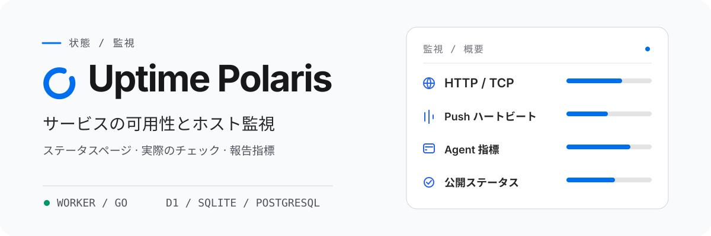

<h1 align="center">
  <picture>
    <source media="(prefers-color-scheme: dark)" srcset="assets/readme/overview-ja-JP-dark.svg">
    <source media="(prefers-color-scheme: light)" srcset="assets/readme/overview-ja-JP-light.svg">
    
  </picture>
</h1>

<p align="center"><strong>HTTP/TCP チェック、Push ハートビート、ホスト指標</strong><br>Cloudflare Worker またはセルフホストの Go サーバーで動作します。</p>

Worker は D1 / PostgreSQL、Go は SQLite / PostgreSQL に対応し、フロントエンドは共通です。[Go の起動手順](backends/go/README.md)。

<p align="center">
  <a href="README.md">English</a> · <a href="README-zh-CN.md">简体中文</a> · <a href="README-zh-TW.md">繁體中文（台灣）</a> · <a href="README-zh-HK.md">繁體中文（香港）</a> · <strong>日本語</strong> · <a href="README-ko-KR.md">한국어</a> · <a href="README-fr-FR.md">Français</a> · <a href="README-pt-BR.md">Português (Brasil)</a> · <a href="README-ru-RU.md">Русский</a>
</p>

<p align="center">
  <a href="https://developers.cloudflare.com/workers/"></a>
  <a href="backends/go/README.md"></a>
  <a href="frontend/README.md"></a>
  <a href="https://github.com/XingLingQAQ/polaris-agent"></a>
  <a href="docs/configuration.md"></a>
</p>

<p align="center">
  <a href="#クイックスタート">クイックスタート</a> · <a href="#cloudflare-へのデプロイ">デプロイ</a> · <a href="#deploy-go">Go のデプロイ</a> · <a href="#ホストの監視">Agent</a> · <a href="#ドキュメント">ドキュメント</a>
</p>

Uptime Polaris は、公開ステータスページ、管理コンソール、スケジュール監視を 1 つのアプリケーションにまとめたものです。HTTP/TCP チェックを実行し、Push ハートビートを受け取り、`polaris-agent` でホスト指標を収集し、監視の状態が変わると通知を送ります。

## バックエンドを選ぶ

デプロイごとにどちらか一方を使います。Go は Cloudflare アカウント、D1、R2 が不要です。

保存：Worker は D1 または PostgreSQL を使い、テーマ資産は R2 に置きます。Go は SQLite または PostgreSQL を使い、データとテーマをデータディレクトリに保存します。プローブ：Go は UDP、ICMP、DNS、TLS、WebSocket を直接実行できます。Worker はこれらを直接実行できず、UDP と ICMP はオンライン Agent に任せます。

[バックエンドの比較と起動方法](docs/backends.md)

## 主な機能

<p align="center">
  <br>
  <strong>サービスチェックとハートビート</strong><br>
  HTTP と TCP のチェックに加え、レスポンス、証明書、ドメイン、DNS の判定を設定できます。Push 監視は定期ジョブからのハートビートを受け取ります。
</p>

<p align="center">
  <br>
  <strong>ホスト指標とプローブ</strong><br>
  <code>polaris-agent</code> が CPU、メモリ、ディスク、ネットワーク指標を送信します。ホストから HTTP/TCP チェックを実行することもできます。
</p>

<p align="center">
  <br>
  <strong>ステータスページと通知</strong><br>
  公開ページには現在の状態とイベント履歴が表示されます。表示範囲と通知先はグループ、メンテナンス期間、通知チャネルで決まります。
</p>

<p align="center">
  <br>
  <strong>ストレージとテーマ</strong><br>
  Worker はデータを D1 または PostgreSQL、テーマ資産を R2 に保存します。Go はデータを SQLite または PostgreSQL、テーマをデータディレクトリに保存します。
</p>

Push 監視はレイテンシを測定せず、公開されるレイテンシは `null` です。各バックエンドで使えるプローブは[バックエンドの比較](docs/backends.md)にあります。設定と制限は[利用ガイド](docs/usage.md)を参照してください。

## クイックスタート

バックエンドを選び、対応するガイドに従ってデプロイします。`/setup` で管理者を作成し、`/admin` で最初の監視を追加してください。

### Cloudflare Worker

[Cloudflare へのデプロイ](#cloudflare-へのデプロイ)

### Go

Go の実行ファイルには Web 画面が含まれます。Releases から OS に合うファイルを取得し、[Go ガイド](backends/go/README.md#english)に従って起動してください。

## Cloudflare へのデプロイ

[](https://deploy.workers.cloudflare.com/?url=https://github.com/XingLingQAQ/UptimePolaris)

ボタンはリポジトリをフォークし、デプロイを開始します。Worker とデータベースに新しい名前を付け、`ADMIN_TOKEN` に長いランダム値を設定して Worker Secret に保存してください。データベース ID がない場合は、Cloudflare で D1 データベースを見つけるか作成し、フォークした `wrangler.jsonc` の `database_id` プレースホルダーを実際の ID に置き換えて再デプロイします。手順は[デプロイガイド](docs/deployment.md#通过-cloudflare-按钮部署)にあります。

ボタン用テンプレートがバインドするのは D1、静的アセット、スケジュールだけです。R2 テーマと Analytics Engine は含まれません。Agent のインストールには GitHub Release のダウンロード先へアクセスできる必要があります。

<a id="deploy-go"></a>

## Go バックエンドのデプロイ

プロジェクトの [Releases](https://github.com/XingLingQAQ/UptimePolaris/releases) から OS に合うファイルを取得し、[Go インストールガイド](backends/go/README.md#install-and-start)に従って起動します。Web 画面はバイナリに含まれます。データディレクトリは永続化し、アクセス権を制限してください。バックアップはデータベースを含めてディレクトリごと取得します。

## ホストの監視

コンソールの Agent ページでマシンを作成し、プラットフォームとインストールモードを選び、生成されたコマンドを対象マシンで実行します。インストーラーはそのプラットフォームの最新安定版をダウンロードします。

インストーラーは `polaris-agent` サービスと `pa` コマンドを登録します。どちらも同じプログラム、設定、サービスを操作します。

```sh
pa status
pa restart
pa logs -f
```

`pa start`、`stop`、`restart` にはサービスマネージャーが必要です。手動インストールではフォアグラウンドで実行します。`pa logs` はインストールが作成したログファイルを読みます。インストールコマンドには現在のサイトのプロトコル、ドメイン、ポートが入るため、長く使う予定のアドレスから生成してください。インストールモード、プラットフォームの制限、設定、更新、削除は [Agent ガイド](docs/agents.md)にあります。

## 利用と公開情報

公開ステータスページは匿名で閲覧できます。監視を追加する前に、名前、対象パス、ホスト名、内部アドレスに機密情報がないことを確認してください。公開 API は認証情報を除去しますが、名前やパスに機密情報が含まれていないかは検査しません。詳しくは[公開データの説明](docs/usage.md#公开数据)を参照してください。

通知チャネルは Telegram、Feishu、Slack、Discord、Webhook、Apprise、Server酱です。チャネルは監視グループ単位で範囲を限定できます。設定と配信のトラブルシューティングは[通知ガイド](docs/notifications.md)にあります。

## ドキュメント

| 目的 | ドキュメント |
| --- | --- |
| サイトのデプロイ、ドメインまたは PostgreSQL の設定 | [デプロイガイド](docs/deployment.md) |
| バックエンドの比較 | [Worker / Go](docs/backends.md#english) · [Go](backends/go/README.md#english) |
| 監視の作成、状態と公開データの確認 | [利用ガイド](docs/usage.md) |
| ホスト Agent のインストールと管理 | [Agent ガイド](docs/agents.md) |
| バインディング、環境変数、管理画面の設定 | [設定リファレンス](docs/configuration.md) |
| 通知チャネルと対象範囲の設定 | [通知ガイド](docs/notifications.md) |
| ステータスページのテーマのインストールまたは設定 | [テーマガイド](docs/themes.md#english) |
| API の利用または Push の連携 | [API リファレンス](docs/api.md) |
| バックアップ、アップグレード、トラブルシューティング | [運用ガイド](docs/operations.md) · [よくある質問](docs/troubleshooting.md) |

全体の索引：[docs/README.md](docs/README.md)。

## ライセンス

このプロジェクトは [MIT ライセンス](LICENSE)の下で公開されています。
