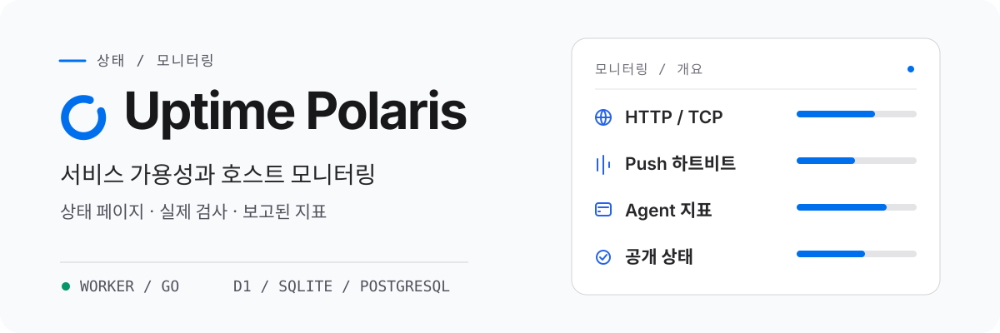

<h1 align="center">
  <picture>
    <source media="(prefers-color-scheme: dark)" srcset="assets/readme/overview-ko-KR-dark.svg">
    <source media="(prefers-color-scheme: light)" srcset="assets/readme/overview-ko-KR-light.svg">
    
  </picture>
</h1>

<p align="center"><strong>HTTP/TCP 검사, Push 하트비트, 호스트 지표</strong><br>Cloudflare Worker 또는 자체 호스팅 Go 서버에서 실행됩니다.</p>

<p align="center">
  <a href="README.md">English</a> · <a href="README-zh-CN.md">简体中文</a> · <a href="README-zh-TW.md">繁體中文（台灣）</a> · <a href="README-zh-HK.md">繁體中文（香港）</a> · <a href="README-ja-JP.md">日本語</a> · <strong>한국어</strong> · <a href="README-fr-FR.md">Français</a> · <a href="README-pt-BR.md">Português (Brasil)</a> · <a href="README-ru-RU.md">Русский</a>
</p>

<p align="center">
  <a href="https://developers.cloudflare.com/workers/"></a>
  <a href="backends/go/README.md"></a>
  <a href="frontend/README.md"></a>
  <a href="https://github.com/XingLingQAQ/polaris-agent"></a>
  <a href="docs/configuration.md"></a>
</p>

<p align="center">
  <a href="#빠른-시작">빠른 시작</a> · <a href="#cloudflare에-배포">배포</a> · <a href="#deploy-go">Go 배포</a> ·
  <a href="#호스트-모니터링">Agent</a> ·
  <a href="#문서">문서</a>
</p>

Uptime Polaris는 사이트와 포트를 주기적으로 검사하고, 예약 작업이 보내는 하트비트를 받고, 서버의 CPU·메모리·디스크 지표를 수집하며, 모니터 상태가 바뀌면 알림을 보냅니다. 공개 상태 페이지와 관리 콘솔이 포함되어 있습니다.

## 백엔드 선택

배포할 때마다 백엔드 하나를 선택합니다. 두 백엔드는 같은 화면을 제공합니다.

| | Cloudflare Worker | Go |
| --- | --- | --- |
| 실행 환경 | Cloudflare | 자체 서버 또는 컨테이너 |
| 데이터베이스 | D1 또는 PostgreSQL | SQLite 또는 PostgreSQL |
| 직접 프로브 | HTTP, TCP (UDP·ICMP는 Agent 경유) | HTTP, TCP, UDP, ICMP, DNS, TLS, WebSocket |
| 최소 검사 간격 | 60초 | 5초 |
| 테마 파일 | R2 (선택) | 데이터 디렉터리 |

서버를 직접 관리하고 싶지 않다면 Worker를 사용하세요. 내부 네트워크 프로브, 더 많은 프로토콜, 더 짧은 검사 간격이 필요하면 Go를 선택합니다. 자세한 비교는 [백엔드 비교](docs/backends.md)를 참고하세요.

## 주요 기능

<p align="center">
  <br>
  <strong>서비스 검사와 하트비트</strong><br>
  HTTP·TCP 검사에 응답 내용, 인증서, 도메인 만료, DNS 검증을 추가할 수 있습니다. Push 모니터는 cron과 백업 스크립트에 적합하며, 정해진 시간 안에 하트비트가 없으면 비정상으로 판단합니다.
</p>

<p align="center">
  <br>
  <strong>서버 모니터링</strong><br>
  <code>polaris-agent</code>가 CPU·메모리·디스크·부하·네트워크 지표를 보고합니다. 호스트에서 HTTP·TCP 검사를 실행해 내부 서비스를 확인할 수도 있습니다.
</p>

<p align="center">
  <br>
  <strong>상태 페이지와 알림</strong><br>
  상태 페이지는 현재 상태와 이벤트 기록을 보여 주며 그룹과 유지보수 기간을 지원합니다. 알림 채널은 Telegram, Feishu, Slack, Discord, Webhook, Apprise, Server酱이며 채널별로 담당 모니터 그룹을 제한할 수 있습니다.
</p>

<p align="center">
  <br>
  <strong>스토리지와 테마</strong><br>
  Worker는 데이터를 D1 또는 PostgreSQL에, 테마를 R2에 저장합니다. Go는 데이터를 SQLite 또는 PostgreSQL에, 테마를 데이터 디렉터리에 저장합니다.
</p>

## 빠른 시작

1. [Cloudflare](#cloudflare에-배포) 또는 [자체 서버](#deploy-go)에 배포합니다.
2. 사이트의 `/setup`을 엽니다. Worker는 바인딩과 시크릿을 먼저 검사하고, Go는 시작 로그의 초기 설정 키를 입력합니다.
3. 관리자 계정을 만들고 `/admin`에서 모니터를 추가합니다.

## Cloudflare에 배포

1. 이 저장소를 Fork합니다.
2. Cloudflare 대시보드에서 **Workers & Pages → Create application → GitHub**을 열고 fork한 저장소를 선택합니다. 빌드 명령에 `npm run build`, 배포 명령에 `npm run deploy`를 입력합니다.
3. 배포 후 사이트를 엽니다. 초기 설정 페이지가 바인딩과 시크릿을 먼저 검사하므로, Worker의 **Settings**에서 다음을 설정합니다.
   - **데이터베이스(택 1)**: D1을 쓰려면 **Bindings**에서 변수 이름 `DB`로 데이터베이스를 추가합니다. PostgreSQL을 쓰려면 **Variables and Secrets**에서 Secret `DATABASE_URL`을 추가합니다. D1을 바인딩하지 않으면 자동으로 PostgreSQL로 처리됩니다.
   - **초기 설정 키**: **Variables and Secrets**에서 Secret `ADMIN_TOKEN`을 추가하고 충분히 긴 임의의 값(예: `openssl rand -hex 32` 출력)을 넣습니다.
   - **Analytics Engine (필수)**: 대시보드에서 Analytics Engine을 활성화하고 **Bindings**에서 바인딩 이름 `UPTIME`으로 데이터셋을 추가합니다.
   - **선택**: 외부 테마를 사용하려면 바인딩 이름 `THEMES`로 R2 버킷을 추가합니다. 초기화 후에도 추가할 수 있습니다.
4. 초기 설정 페이지에서 다시 확인을 누르고, 다음 단계로 넘어가 `ADMIN_TOKEN`을 입력해 관리자 계정을 만듭니다.

업그레이드는 GitHub에서 Sync fork만 실행하면 됩니다. Workers Builds가 자동으로 다시 배포하며 대시보드에서 추가한 바인딩도 유지됩니다.

아래 버튼으로도 배포할 수 있습니다. 버튼 배포는 GitHub 계정에 새 저장소를 만들기 때문에(Sync fork로 업데이트할 수 없음) 데이터베이스와 시크릿은 초기 설정 페이지의 안내에 따라 설정하세요.

[](https://deploy.workers.cloudflare.com/?url=https://github.com/XingLingQAQ/UptimePolaris)

명령줄 배포와 PostgreSQL 설정은 [배포 안내서](docs/deployment.md)를 참고하세요.

<a id="deploy-go"></a>

## Go 백엔드 배포

[Releases](https://github.com/XingLingQAQ/UptimePolaris/releases)에서 OS와 아키텍처에 맞는 파일을 내려받아 `polaris`(Windows는 `polaris.exe`)로 이름을 바꾼 뒤 실행합니다.

```sh
chmod +x polaris   # Linux / macOS
./polaris --data-dir ./data
```

```powershell
.\polaris.exe --data-dir .\data
```

기본적으로 `127.0.0.1:8080`에서 수신합니다. 외부에서 접근하려면 `--addr`을 바꾸거나 리버스 프록시를 설정하세요. 모든 데이터는 `./data`에 저장되므로 이 디렉터리를 영구 저장하고 접근 권한을 제한하며 주기적으로 백업해야 합니다. 자세한 설정은 [Go 백엔드 설명](backends/go/README.md#install-and-start)을 참고하세요.

## 호스트 모니터링

콘솔의 Agent 페이지에서 머신을 추가하고 플랫폼과 설치 방식을 고른 뒤, 생성된 명령을 대상 머신에서 실행합니다. 대상 머신은 GitHub에 접근할 수 있어야 합니다.

설치 후에는 `pa`(`polaris-agent`의 짧은 명령)로 서비스를 관리합니다.

```sh
pa status
pa restart
pa logs -f
```

- 설치 명령에는 사이트 주소와 해당 머신의 Token이 들어 있습니다. 운영 도메인에서 생성하고 공개하지 마세요.
- 머신을 추가해도 모니터는 자동으로 만들어지지 않습니다. 온라인 상태나 리소스 임계값을 보려면 모니터 페이지에서 Agent 유형 모니터를 추가하세요.
- 수동 설치에는 서비스 관리자가 없으므로 `pa start`, `stop`, `restart`를 쓸 수 없습니다.

자세한 내용은 [Agent 안내서](docs/agents.md)를 참고하세요.

## 사용과 공개 정보

상태 페이지는 로그인 없이 볼 수 있습니다. 모니터 이름, 대상 경로, 호스트 이름이 공개 페이지와 API에 나타날 수 있으므로 내부 주소나 시크릿을 넣지 마세요. 자세한 내용은 [공개 데이터](docs/usage.md#公开数据)와 [알림 안내서](docs/notifications.md)를 참고하세요.

## 문서

| 문서 | 내용 |
| --- | --- |
| [백엔드 비교](docs/backends.md) | Worker와 Go의 차이 |
| [배포 안내서](docs/deployment.md) | Fork·버튼·수동 배포, 도메인, PostgreSQL, D1에서 PostgreSQL로 이전 |
| [Go 백엔드](backends/go/README.md) | 시작 옵션, 환경 변수, SQLite에서 PostgreSQL로 이전 |
| [사용 안내서](docs/usage.md) | 모니터 설정, Push, 상태와 가용성 |
| [Agent 안내서](docs/agents.md) | 설치, 관리, 설정, 업데이트, 제거 |
| [알림 안내서](docs/notifications.md) | 채널 설정, 그룹 범위, 전송 기록 |
| [테마 안내서](docs/themes.md) | 설치, 설정, 미리보기 |
| [설정 참고서](docs/configuration.md) | 바인딩, 환경 변수, 콘솔 설정 |
| [API 참고서](docs/api.md) | 엔드포인트, 인증, 예제 |
| [운영 안내서](docs/operations.md) | 백업, 복구, 업그레이드, 데이터 보존 |
| [자주 묻는 질문](docs/troubleshooting.md) | 증상별 문제 해결 |

## 라이선스

이 프로젝트는 [MIT 라이선스](LICENSE)를 따릅니다.
