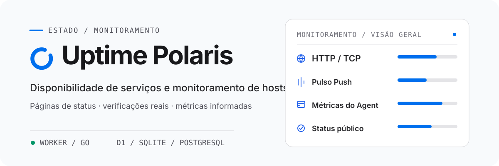

<h1 align="center">
  <picture>
    <source media="(prefers-color-scheme: dark)" srcset="assets/readme/overview-pt-BR-dark.svg">
    <source media="(prefers-color-scheme: light)" srcset="assets/readme/overview-pt-BR-light.svg">
    
  </picture>
</h1>

<p align="center"><strong>Verificações HTTP/TCP, heartbeats Push, métricas de hosts</strong><br>Executa no Cloudflare Workers ou em um servidor Go auto-hospedado.</p>

Armazenamento: D1 ou PostgreSQL no Worker; SQLite ou PostgreSQL no Go. [Começar com Go](backends/go/README.md).

<p align="center">
  <a href="README.md">English</a> · <a href="README-zh-CN.md">简体中文</a> · <a href="README-zh-TW.md">繁體中文（台灣）</a> · <a href="README-zh-HK.md">繁體中文（香港）</a> · <a href="README-ja-JP.md">日本語</a> · <a href="README-ko-KR.md">한국어</a> · <a href="README-fr-FR.md">Français</a> · <strong>Português (Brasil)</strong> · <a href="README-ru-RU.md">Русский</a>
</p>

<p align="center">
  <a href="https://developers.cloudflare.com/workers/"></a>
  <a href="backends/go/README.md"></a>
  <a href="frontend/README.md"></a>
  <a href="https://github.com/XingLingQAQ/polaris-agent"></a>
  <a href="docs/configuration.md"></a>
</p>

<p align="center">
  <a href="#início-rápido">Início rápido</a> ·
  <a href="#implantação-no-cloudflare">Implantação</a> · <a href="#deploy-go">Implantar Go</a> ·
  <a href="#monitoramento-de-hosts">Agent</a> ·
  <a href="#documentação">Documentação</a>
</p>

O Uptime Polaris reúne página pública de status, console de administração e monitoramento agendado em uma única aplicação. Ele executa verificações HTTP/TCP, recebe heartbeats Push, coleta métricas de hosts com o `polaris-agent` e envia notificações quando um monitor muda de estado.

## Escolha o backend

Cada implantação usa um backend. O Go funciona sem conta Cloudflare, D1 ou R2.

Armazenamento: o Worker usa D1 ou PostgreSQL e guarda os temas no R2. O Go usa SQLite ou PostgreSQL e guarda dados e temas no diretório de dados. Sondas: o Go executa UDP, ICMP, DNS, TLS e WebSocket diretamente. O Worker não executa essas sondas diretamente; UDP e ICMP passam por um Agent online.

[Comparação e inicialização dos backends](docs/backends.md)

## Recursos

<p align="center">
  <br>
  <strong>Verificações de serviços e sinais de vida</strong><br>
  Verificações HTTP e TCP, com asserções de resposta, certificado, domínio e DNS. Monitores Push recebem heartbeats de tarefas agendadas.
</p>

<p align="center">
  <br>
  <strong>Métricas e sondagens de hosts</strong><br>
  O <code>polaris-agent</code> reporta métricas de CPU, memória, disco e rede. Ele também pode executar verificações HTTP/TCP a partir do host.
</p>

<p align="center">
  <br>
  <strong>Página de status e notificações</strong><br>
  A página pública mostra o estado atual e o histórico de eventos. Grupos, janelas de manutenção e canais definem o que aparece e quem recebe notificações.
</p>

<p align="center">
  <br>
  <strong>Armazenamento e temas</strong><br>
  O Worker guarda dados no D1 ou PostgreSQL e temas no R2. O Go guarda dados no SQLite ou PostgreSQL e temas no diretório de dados.
</p>

Monitores Push não medem latência; o campo público de latência é `null`. As sondas de cada backend estão na [comparação de backends](docs/backends.md). Configuração e limites: [manual de uso](docs/usage.md).

## Início rápido

Escolha um backend e siga o guia de implantação correspondente. Abra `/setup`, crie um administrador e adicione o primeiro monitor em `/admin`.

### Cloudflare Worker

[Implantação no Cloudflare](#implantação-no-cloudflare)

### Go

O executável Go inclui a interface web. Baixe a versão do seu sistema na página Releases e siga o [guia Go](backends/go/README.md#english).

## Implantação no Cloudflare

[](https://deploy.workers.cloudflare.com/?url=https://github.com/XingLingQAQ/UptimePolaris)

O botão faz fork do repositório e inicia a implantação. Dê novos nomes ao Worker e ao banco de dados, defina `ADMIN_TOKEN` com um valor aleatório longo e salve-o como segredo do Worker. Se faltar o ID do banco, localize ou crie o banco D1 no Cloudflare, substitua o valor provisório de `database_id` no `wrangler.jsonc` do repositório com fork e implante novamente. O [guia de implantação](docs/deployment.md#通过-cloudflare-按钮部署) traz as etapas exatas.

O modelo do botão vincula apenas D1, assets estáticos e agendamentos. Temas no R2 e Analytics Engine não estão incluídos. A instalação do Agent precisa de acesso aos downloads do GitHub Release.

<a id="deploy-go"></a>

## Implantar o backend Go

Baixe a versão do seu sistema nas [Releases](https://github.com/XingLingQAQ/UptimePolaris/releases) e siga o [guia de instalação Go](backends/go/README.md#install-and-start). O binário inclui a interface web. Mantenha o diretório de dados persistente, restrinja o acesso e faça backup do banco junto com o restante do diretório.

## Monitoramento de hosts

Na página Agent do console, crie uma máquina, escolha a plataforma e o modo de instalação e execute o comando gerado na máquina de destino. O instalador baixa a última versão estável para essa plataforma.

O instalador registra o serviço `polaris-agent` e o comando `pa`. Os dois operam no mesmo programa, configuração e serviço:

```sh
pa status
pa restart
pa logs -f
```

`pa start`, `stop` e `restart` exigem um gerenciador de serviços; instalações manuais rodam em primeiro plano. `pa logs` lê o arquivo de log criado pela instalação. O comando de instalação usa o protocolo, o domínio e a porta do site acessado; gere-o a partir do endereço que você pretende manter. Modos de instalação, limites de plataforma, configuração, atualização e remoção estão no [manual do Agent](docs/agents.md).

## Uso e informações públicas

A página pública de status é anônima. Antes de adicionar um monitor, confirme que o nome, o caminho de destino, o hostname e os endereços internos não contêm informação sensível. As APIs públicas removem dados de autenticação; elas não verificam se nomes ou caminhos contêm conteúdo sensível. Veja [dados públicos](docs/usage.md#公开数据).

Os canais de notificação são Telegram, Feishu, Slack, Discord, Webhook, Apprise e Server酱. Um canal pode ser limitado a grupos de monitores. Configuração e solução de problemas de entrega: [guia de notificações](docs/notifications.md).

## Documentação

| Tarefa | Documento |
| --- | --- |
| Implantar o site ou configurar domínio ou PostgreSQL | [Guia de implantação](docs/deployment.md) |
| Comparar backends | [Worker / Go](docs/backends.md#english) · [Go](backends/go/README.md#english) |
| Criar monitores e consultar status ou dados públicos | [Manual de uso](docs/usage.md) |
| Instalar e gerenciar o Agent de hosts | [Manual do Agent](docs/agents.md) |
| Configurar bindings, variáveis de ambiente e configurações administrativas | [Referência de configuração](docs/configuration.md) |
| Configurar canais e escopos de notificação | [Guia de notificações](docs/notifications.md) |
| Instalar ou configurar temas para a página de status | [Guia de temas](docs/themes.md#english) |
| Usar a API ou integrar Push | [Referência da API](docs/api.md) |
| Fazer backup, atualizar e solucionar problemas | [Guia de operações](docs/operations.md) · [Perguntas frequentes](docs/troubleshooting.md) |

Índice completo: [docs/README.md](docs/README.md).

## Licença

Este projeto está disponível sob a [licença MIT](LICENSE).
