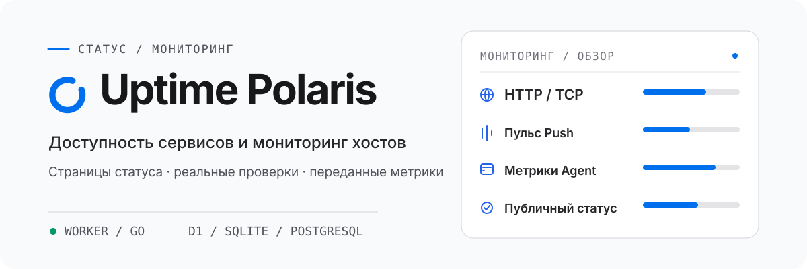

<div align="center">

<picture>
  <source media="(prefers-color-scheme: dark)" srcset="assets/readme/overview-ru-RU-dark.svg">
  <source media="(prefers-color-scheme: light)" srcset="assets/readme/overview-ru-RU-light.svg">
  
</picture>

<a href="README.md">English</a> · <a href="README-zh-CN.md">简体中文</a> · <a href="README-zh-TW.md">繁體中文（台灣）</a> · <a href="README-zh-HK.md">繁體中文（香港）</a> · <a href="README-ja-JP.md">日本語</a> · <a href="README-ko-KR.md">한국어</a> · <a href="README-fr-FR.md">Français</a> · <a href="README-pt-BR.md">Português (Brasil)</a> · <strong>Русский</strong>

# Uptime Polaris - собственная страница статуса и мониторинг доступности

Uptime Polaris по расписанию проверяет сайты, порты и задачи планировщика, собирает метрики серверов и отправляет уведомление при смене статуса.<br>
Работает на Cloudflare Workers — обслуживать сервер не нужно — или как бэкенд Go на вашей машине.<br>
Есть публичная страница статуса и консоль администратора; интерфейс переведён на 9 языков.

<p>
  <a href="https://developers.cloudflare.com/workers/"></a>
  <a href="backends/go/README.md"></a>
  <a href="frontend/README.md"></a>
  <a href="https://github.com/XingLingQAQ/polaris-agent"></a>
  <a href="docs/configuration.md"></a>
</p>

<p><a href="#возможности">Возможности</a> · <a href="#развёртывание">Развёртывание</a> · <a href="#быстрый-старт">Быстрый старт</a> · <a href="#мониторинг-хостов">Agent</a> · <a href="#данные-и-публичный-доступ">Публичный доступ</a> · <a href="#частые-вопросы">Частые вопросы</a> · <a href="#документация">Документация</a></p>

</div>

## Почему Uptime Polaris

- **Не нужен сервер**: на Cloudflare Workers проверки, уведомления и страница статуса работают на стороне Cloudflare. Если нужно проверять внутреннюю сеть или делать проверки чаще, переключитесь на бэкенд Go — интерфейс тот же.
- **Статус из реальных результатов**: страница показывает только то, что реально дали проверка или отчёт. Отсутствующие данные показываются как ожидание, а не как норма.
- **Задачи планировщика тоже под контролем**: скрипты резервного копирования и задачи cron присылают сигнал в срок, а пропущенный сигнал считается сбоем.
- **Метрики серверов**: `polaris-agent` передаёт CPU, память, диск, нагрузку и сеть, а также может проверять внутренние сервисы с машины, у которой есть до них доступ.
- **Две публичные страницы**: страница статуса мониторов и страница машин — отдельные, каждой можно назначить свой домен. Во время обслуживания обе переключаются на страницу обслуживания.
- **Уведомления по группам**: Telegram, Feishu, Slack, Discord, Webhook, Apprise и ServerChan, у каждого канала свой набор групп.
- **Выбор базы данных**: D1 или PostgreSQL в варианте Worker, SQLite или PostgreSQL в Go; существующие данные можно перенести в PostgreSQL.

## Возможности

###  Проверки и сигналы

- Проверки HTTP контролируют код ответа, поля JSON, заголовки ответа и время ответа. Проверки TCP контролируют открытие порта, а также могут отправить данные и сравнить ответ.
- Бэкенд Go дополнительно проверяет UDP, ICMP, DNS, TLS и WebSocket напрямую. В варианте Worker проверки UDP и ICMP выполняются через Agent.
- Дополнительные проверки охватывают срок действия сертификата SSL, срок регистрации домена и записи DNS.
- Мониторы Push получают отдельный адрес; задача планировщика отправляет на него POST, а отсутствие POST считается сбоем.
- Минимальный интервал — 60 секунд в варианте Worker и 5 секунд в Go. Если цель доступна только из внутренней сети, укажите Agent как источник проверки.

Типы мониторов и все поля описаны в [руководстве по использованию](docs/usage.md).

###  Мониторинг серверов

- `polaris-agent` передаёт CPU, память, диск, нагрузку, сеть и точки монтирования в Linux, macOS и Windows; в Linux поддерживается Docker.
- Правила ресурсов задают порог и длительность, поэтому предупреждение вызывает только устойчивое превышение. Восстановление считается как доля порога, что сглаживает колебания у границы.
- Страница статуса машин включается по желанию: поиск, фильтры, карта и сравнение 2–4 машин. По умолчанию она выключена, и машины видны только администратору до публикации.

Установка, управление и обновления описаны в [руководстве по Agent](docs/agents.md).

###  Страницы статуса и уведомления

- Страница статуса показывает текущее состояние, доступность и историю событий с группировкой по вашему выбору; видны только мониторы, отмеченные публичными.
- Окна обслуживания бывают разовыми или еженедельными. Перед началом над страницей появляется объявление, а на время окна автоматические уведомления приостанавливаются.
- У каждого канала свой язык сообщений и набор групп. Консоль хранит журнал доставки, различая успешную отправку, отказ провайдера и сетевой таймаут.

Настройка каналов и охват групп описаны в [руководстве по уведомлениям](docs/notifications.md).

###  Хранение и темы

- D1 или PostgreSQL в варианте Worker, SQLite или PostgreSQL в Go; данные D1 и SQLite можно перенести в PostgreSQL.
- Сторонние темы устанавливаются на публичные страницы из ZIP или по ссылке и доступны для предпросмотра перед применением. В варианте Worker темы хранятся в R2, в Go — в каталоге данных.
- Без темы используется встроенное оформление. Консоль администратора всегда использует встроенный интерфейс.

Установка и создание тем описаны в [руководстве по темам](docs/themes.md).

### Кроме того

- **Палитра команд**: нажмите `Ctrl+K` (в macOS `⌘K`) в консоли, чтобы искать страницы, мониторы и Agent.
- **Всплывающая сводка**: в шапке консоли собраны сбоящие мониторы и офлайн-Agent, с действиями «приостановить», «проверить сейчас» и «скопировать сводку».
- **API**: эндпоинты управления принимают Bearer-токен, поэтому мониторами можно управлять из скриптов. См. [справочник API](docs/api.md).
- **Языки интерфейса**: упрощённый китайский, традиционный китайский (Тайвань, Гонконг), английский, японский, корейский, французский, португальский и русский.

## Развёртывание

Для каждого развёртывания выберите один бэкенд; интерфейс у обоих одинаковый.

| | Cloudflare Worker | Go |
| --- | --- | --- |
| Среда | Cloudflare | Свой сервер или контейнер |
| База данных | D1 или PostgreSQL | SQLite или PostgreSQL |
| Прямые проверки | HTTP, TCP (UDP и ICMP — через Agent) | HTTP, TCP, UDP, ICMP, DNS, TLS, WebSocket |
| Минимальный интервал | 60 секунд | 5 секунд |
| Файлы тем | R2 (необязательно) | Каталог данных |

Выбирайте Worker, если не хотите обслуживать сервер. Выбирайте Go, если нужно проверять внутренние сервисы, использовать больше протоколов или проверять чаще. Подробности — в [сравнении бэкендов](docs/backends.md).

### Развёртывание в Cloudflare

1. Сделайте fork этого репозитория.
2. В панели Cloudflare откройте **Workers & Pages → Create application → GitHub** и выберите свой fork. В качестве команды сборки укажите `npm run build`, команды развёртывания — `npm run deploy`.
3. Откройте сайт после завершения развёртывания. Страница настройки сначала проверяет привязки и секреты. Настройте следующее в **Settings** Worker, как подсказывает страница:
   - **D1 (необязательно)**: для D1 добавьте базу в **Bindings** с именем переменной `DB`. Без D1 при настройке доступен только PostgreSQL.
   - **KV (для настройки PostgreSQL на странице)**: добавьте пространство имён KV в **Bindings** с именем переменной `CONFIG` для зашифрованного хранения адресов подключения. Необязательно при использовании только D1 или `DATABASE_URL`, заданного при развёртывании.
   - **Ключ настройки**: добавьте секрет `ADMIN_TOKEN` в **Variables and Secrets** с длинным случайным значением, например выводом команды `openssl rand -hex 32`.
   - **Analytics Engine (обязательно)**: включите Analytics Engine в панели и добавьте набор данных в **Bindings** с именем переменной `UPTIME`.
   - **R2 (необязательно)**: нужен для сторонних тем. Добавьте бакет в **Bindings** с именем переменной `THEMES` или добавьте его после настройки.
4. На странице настройки нажмите **Re-check**. После проверки обязательных пунктов введите `ADMIN_TOKEN`, настройте и проверьте базу, затем создайте учётную запись администратора.

Есть также кнопка развёртывания. Она создаёт новый репозиторий в вашей учётной записи GitHub, а не fork, поэтому Sync fork не сможет его обновить. База и секреты настраиваются так же со страницы настройки:

[](https://deploy.workers.cloudflare.com/?url=https://github.com/XingLingQAQ/UptimePolaris)

Развёртывание из командной строки и PostgreSQL описаны в [руководстве по развёртыванию](docs/deployment.md).

<a id="deploy-go"></a>

### Развёртывание бэкенда Go

Скачайте сборку для своей системы и архитектуры со страницы [Releases](https://github.com/XingLingQAQ/UptimePolaris/releases), переименуйте её в `polaris` (`polaris.exe` в Windows) и запустите:

```sh
chmod +x polaris   # Linux / macOS
./polaris --data-dir ./data
```

```powershell
.\polaris.exe --data-dir .\data
```

По умолчанию он слушает `127.0.0.1:8080`; измените `--addr` или поставьте перед ним обратный прокси. Все данные находятся в `./data`, каталогу нужны постоянное хранение, ограниченные права и регулярные резервные копии. Параметры запуска и переменные окружения — в [руководстве по бэкенду Go](backends/go/README.md#install-and-start).

## Быстрый старт

1. Откройте `/setup` на своём сайте. Worker сначала проверяет привязки и секреты, затем принимает `ADMIN_TOKEN`; Go принимает ключ настройки из журнала запуска. Создайте учётную запись администратора.
2. Перейдите в `/admin` и добавьте монитор в разделе **Monitors**. Например, выберите HTTP, введите `https://example.com/health`, сохраните и выберите «Проверить сейчас».
3. Добавьте канал в разделе **Notifications** и отправьте тестовое сообщение.
4. Откройте корень сайта в приватном окне браузера и проверьте, что показывает страница статуса.

При первом входе обзор показывает список начала работы: добавить монитор, задать имя сайта, настроить уведомления, подключить Agent.

## Мониторинг хостов

Добавьте машину в **Agent management** в консоли, выберите платформу и способ установки, затем выполните сгенерированную команду на целевой машине. Машине нужен доступ к GitHub.

После установки управляйте службой через `pa` (сокращение от `polaris-agent`):

```sh
pa status
pa restart
pa logs -f
```

- Команда установки содержит адрес сайта и токен этой машины. Генерируйте её на своём домене и не публикуйте.
- Добавление машины не создаёт монитор. Добавьте монитор типа **Agent host** в разделе **Monitors**.
- В режиме ручной установки нет менеджера служб, поэтому `pa start`, `stop` и `restart` недоступны.

Режимы установки и различия платформ описаны в [руководстве по Agent](docs/agents.md).

## Обновление и удаление

### Обновление

Сначала сделайте резервную копию базы; полная процедура — в [руководстве по эксплуатации](docs/operations.md#upgrade).

- **Cloudflare**: для fork выберите Sync fork на GitHub, и Workers Builds переразвернёт автоматически, сохранив привязки, добавленные в панели. При установке кнопкой нужно слить новую версию в созданный репозиторий.
- **Go**: остановите службу и сделайте резервную копию каталога данных, замените бинарник и запустите с тем же каталогом данных.
- **Agent**: выполните `pa update` на машине. Управляемые установки могут включить автообновление в консоли; по умолчанию оно выключено.

### Удаление

- **Cloudflare**: удалите Worker в панели. База D1, бакет R2 и база PostgreSQL вместе с ним не удаляются; удалите их отдельно, если они больше не нужны.
- **Go**: остановите службу, затем удалите бинарник и каталог данных. Если используется PostgreSQL, удалите и эту базу.
- **Agent**: скачайте скрипт установки со своего сайта и запустите удаление:

  ```sh
  curl -fsSL 'https://status.example.com/install.sh' -o install.sh
  sh install.sh --uninstall
  ```

  Для Windows см. [руководство по Agent](docs/agents.md#update-rollback-and-uninstall). Удаление Agent не удаляет его мониторы из консоли.

## Данные и публичный доступ

- Данные остаются в вашем развёртывании: D1 в вашей учётной записи Cloudflare или ваш PostgreSQL для Worker, SQLite в каталоге данных или ваш PostgreSQL для Go.
- Страница статуса и публичный API доступны без входа. Имена мониторов, хост и путь HTTP-целей, а также хост и порт TCP-целей видны публично, поэтому не указывайте там внутренние адреса и секреты.
- Имена пользователей, пароли и строки запроса HTTP-целей удаляются; учётные данные и токены Agent никогда не попадают в публичные данные.
- Токен в адресе Push — это учётные данные монитора для отчётов. Не публикуйте его.
- Если монитор не должен быть публичным, выберите «Скрыть со страницы статуса» в списке мониторов, и он останется видимым только администратору.
- Проверка SSL в Worker обращается к публичным журналам прозрачности сертификатов, а Agent при запуске определяет регион публичного IP машины и обращается к GitHub при обновлении.

Какие поля возвращают публичные страницы и API, описано в разделе [публичные данные](docs/usage.md).

## Частые вопросы

**Страница настройки останавливается на проверке развёртывания и не продолжает.**
Задайте обязательные `ADMIN_TOKEN` и `UPTIME` в **Settings** Worker, сохраните и разверните изменения, затем повторите проверку. D1 и R2 необязательны; без D1 настройте подключение PostgreSQL на следующем шаге.

**Открытие адреса Push в браузере не даёт данных.**
Браузер отправляет GET, а Push принимает только POST, поэтому GET возвращает 405. Используйте `curl -X POST` или отправляйте POST из задачи планировщика.

**Тест уведомления проходит, но при реальных сбоях ничего не приходит.**
Проверьте, что канал включён, его набор групп содержит монитор и не открыто окно обслуживания. Канал без выбранных групп получает все мониторы.

**Agent отображается как офлайн.**
Выполните на машине `pa status` и `pa logs -f`, убедитесь, что служба работает и достигает домена сайта. По умолчанию отчёты идут каждые 60 секунд, и примерно через 3 минуты без отчёта машина считается офлайн.

Другие случаи — в разделе [устранение неполадок](docs/troubleshooting.md). Если проблема осталась, откройте [issue](https://github.com/XingLingQAQ/UptimePolaris/issues).

## Документация

| Документ | Содержание |
| --- | --- |
| [Выбор бэкенда](docs/backends.md) | Различия между Worker и Go |
| [Развёртывание](docs/deployment.md) | Развёртывание через fork, кнопкой и вручную, домены, PostgreSQL, переход с D1 на PostgreSQL |
| [Бэкенд Go](backends/go/README.md) | Параметры запуска, переменные окружения, переход с SQLite на PostgreSQL |
| [Использование](docs/usage.md) | Консоль, настройка мониторов, Push, страница статуса, окна обслуживания, учётная запись и безопасность |
| [Agent](docs/agents.md) | Установка, управление, настройка, обновление, удаление |
| [Уведомления](docs/notifications.md) | Настройка каналов, охват групп, журнал доставки |
| [Темы](docs/themes.md) | Установка, настройка, предпросмотр |
| [Справочник по настройке](docs/configuration.md) | Привязки, переменные окружения, настройки консоли |
| [Справочник API](docs/api.md) | Эндпоинты, аутентификация, примеры |
| [Эксплуатация](docs/operations.md) | Резервное копирование, восстановление, обновление, хранение данных |
| [Устранение неполадок](docs/troubleshooting.md) | Диагностика по симптомам |

## Лицензия

Uptime Polaris распространяется по [лицензии MIT](LICENSE).
