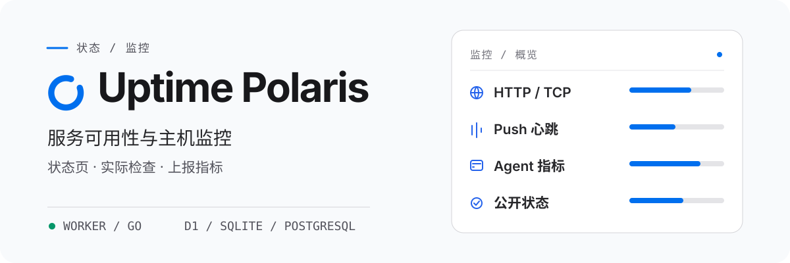

<h1 align="center">
  <picture>
    <source media="(prefers-color-scheme: dark)" srcset="assets/readme/overview-zh-CN-dark.svg">
    <source media="(prefers-color-scheme: light)" srcset="assets/readme/overview-zh-CN-light.svg">
    
  </picture>
</h1>

<p align="center"><strong>HTTP/TCP 检查、Push 心跳、主机指标</strong><br>运行在 Cloudflare Worker 或自托管的 Go 后端上。</p>


<p align="center">
  <a href="README.md">English</a> · <strong>简体中文</strong> · <a href="README-zh-TW.md">繁體中文（台灣）</a> · <a href="README-zh-HK.md">繁體中文（香港）</a> · <a href="README-ja-JP.md">日本語</a> · <a href="README-ko-KR.md">한국어</a> · <a href="README-fr-FR.md">Français</a> · <a href="README-pt-BR.md">Português (Brasil)</a> · <a href="README-ru-RU.md">Русский</a>
</p>

<p align="center">
  <a href="https://developers.cloudflare.com/workers/"></a>
  <a href="backends/go/README.md"></a>
  <a href="frontend/README.md"></a>
  <a href="agent/README.md"></a>
  <a href="docs/configuration.md"></a>
</p>

<p align="center">
  <a href="#快速开始">快速开始</a> ·
  <a href="#部署到-cloudflare">部署</a> · <a href="#deploy-go">Go 部署</a> ·
  <a href="#监控主机">Agent</a> ·
  <a href="#文档">文档</a>
</p>

Uptime Polaris 在一个应用里提供公开状态页、管理后台和定时检查。它执行 HTTP/TCP 检查，接收 Push 心跳，通过 `polaris-agent` 采集主机指标，并在监控状态变化时发送通知。

## 选择后端

每次部署选一种后端。Go 不需要 Cloudflare 账号、D1 或 R2。

存储：Worker 用 D1 或 PostgreSQL，R2 主题存储可选；Go 用 SQLite 或 PostgreSQL，主题存在数据目录。探测：Go 后端另支持 UDP、ICMP、DNS、TLS 和 WebSocket 原生探测；Worker 不能直接执行这些探测，UDP 和 ICMP 要交给在线 Agent。

[后端对比与启动方式](docs/backends.md)

## 能做什么

<p align="center">
  <br>
  <strong>服务检查与心跳</strong><br>
  HTTP 和 TCP 检查，以及响应、证书、域名和 DNS 断言。Push 监控接收定时任务发送的心跳。
</p>

<p align="center">
  <br>
  <strong>主机指标与探测</strong><br>
  <code>polaris-agent</code> 上报 CPU、内存、磁盘和网络指标，也能从主机发起 HTTP/TCP 检查。
</p>

<p align="center">
  <br>
  <strong>状态页与通知</strong><br>
  公开状态页显示当前状态和事件历史。分组、维护窗口和通知渠道决定展示范围和通知对象。
</p>

<p align="center">
  <br>
  <strong>存储与主题</strong><br>
  Worker 把数据存在 D1 或 PostgreSQL，把主题资产存在 R2；Go 把数据存在 SQLite 或 PostgreSQL，主题存放在数据目录。
</p>

Push 监控不测延迟，公开延迟字段为 `null`。各后端能执行的探测类型见[后端对比](docs/backends.md)。配置和限制见[使用手册](docs/usage.md)。

## 快速开始

选一个后端，按对应指南部署。打开 `/setup` 创建管理员，再到 `/admin` 添加第一个监控。

### Cloudflare Worker

[部署到 Cloudflare](#部署到-cloudflare)

### Go

Go 可执行文件包含内置界面。到 Releases 页面下载对应系统的版本，再按 [Go 指南](backends/go/README.md)启动。

## 部署到 Cloudflare

[](https://deploy.workers.cloudflare.com/?url=https://github.com/XingLingQAQ/UptimePolaris)

按钮会 fork 仓库并开始部署。给 Worker 和数据库起新名字，把 `ADMIN_TOKEN` 设为足够长的随机值，并保存为 Worker Secret。如果缺数据库 ID，到 Cloudflare 找到或新建 D1 数据库，替换 fork 仓库里 `wrangler.jsonc` 的 `database_id` 占位值，再重新部署。具体步骤见[部署指南](docs/deployment.md#通过-cloudflare-按钮部署)。

按钮模板只绑定 D1、静态资产和调度，不含 R2 主题存储和 Analytics Engine。Agent 安装需要能访问 GitHub Release 下载。

<a id="deploy-go"></a>

## 部署 Go 后端

到 [Releases](https://github.com/XingLingQAQ/UptimePolaris/releases) 页面下载对应系统的版本，按 [Go 安装指南](backends/go/README.md#安装与启动)启动。程序包含内置界面。数据目录要持久保存并限制访问权限；备份时连同数据库一起备份。

## 监控主机

在控制台的 Agent 页面创建机器，选好平台和安装模式，再到目标机器执行生成的安装命令。安装器下载所选平台的最新稳定版。

安装器会注册 `polaris-agent` 服务和 `pa` 命令。两个命令操作同一套程序、配置和服务：

```sh
pa status
pa restart
pa logs -f
```

`pa start`、`stop`、`restart` 需要服务管理器；手动安装以前台进程运行。`pa logs` 读取安装产生的日志文件。安装命令会写入当前站点的协议、域名和端口，请从准备长期使用的站点地址生成。安装模式、平台限制、配置、更新和卸载见 [Agent 手册](docs/agents.md)。

## 使用与公开信息

公开状态页允许匿名访问。添加监控前，确认名称、目标路径、主机名和内网地址不含敏感信息。公开接口会移除认证信息，但不会检查名称和路径里是否写了敏感内容。公开范围见[公开数据说明](docs/usage.md#公开数据)。

通知渠道有 Telegram、飞书、Slack、Discord、Webhook、Apprise 和 Server酱。渠道可按监控分组限定范围。配置与投递排查见[通知指南](docs/notifications.md)。

## 文档

| 任务 | 文档 |
| --- | --- |
| 部署站点、配置域名或 PostgreSQL | [部署指南](docs/deployment.md) |
| 比较后端 | [Worker / Go](docs/backends.md) · [Go](backends/go/README.md) |
| 创建监控、查看状态与公开数据 | [使用手册](docs/usage.md) |
| 安装和管理主机 Agent | [Agent 手册](docs/agents.md) |
| 配置绑定、环境变量和后台设置 | [配置参考](docs/configuration.md) |
| 设置通知渠道和范围 | [通知指南](docs/notifications.md) |
| 安装或配置状态页主题 | [主题指南](docs/themes.md) |
| 调用接口或接入 Push | [API 参考](docs/api.md) |
| 备份、升级与排查故障 | [运维指南](docs/operations.md) · [常见问题](docs/troubleshooting.md) |

完整索引见 [docs/README.md](docs/README.md)。

## 许可证

本项目采用 [MIT 许可证](LICENSE)。
