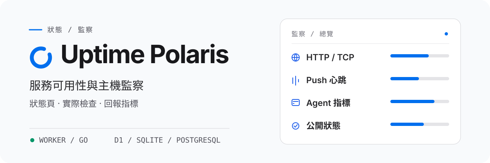

<h1 align="center">
  <picture>
    <source media="(prefers-color-scheme: dark)" srcset="assets/readme/overview-zh-HK-dark.svg">
    <source media="(prefers-color-scheme: light)" srcset="assets/readme/overview-zh-HK-light.svg">
    
  </picture>
</h1>

<p align="center"><strong>HTTP/TCP 檢查、Push 心跳、主機指標</strong><br>可運行於 Cloudflare Worker 或自行託管的 Go 後端。</p>

Worker 使用 D1 / PostgreSQL，Go 使用 SQLite / PostgreSQL，兩者共用前端。[Go 啟動與部署](backends/go/README.md)。

<p align="center">
  <a href="README.md">English</a> · <a href="README-zh-CN.md">简体中文</a> · <a href="README-zh-TW.md">繁體中文（台灣）</a> · <strong>繁體中文（香港）</strong> · <a href="README-ja-JP.md">日本語</a> · <a href="README-ko-KR.md">한국어</a> · <a href="README-fr-FR.md">Français</a> · <a href="README-pt-BR.md">Português (Brasil)</a> · <a href="README-ru-RU.md">Русский</a>
</p>

<p align="center">
  <a href="https://developers.cloudflare.com/workers/"></a>
  <a href="backends/go/README.md"></a>
  <a href="frontend/README.md"></a>
  <a href="agent/README.md"></a>
  <a href="docs/configuration.md"></a>
</p>

<p align="center">
  <a href="#快速開始">快速開始</a> ·
  <a href="#部署到-cloudflare">部署</a> · <a href="#deploy-go">部署 Go</a> ·
  <a href="#監控主機">Agent</a> ·
  <a href="#文檔">文檔</a>
</p>

Uptime Polaris 在一個應用程式裡提供公開狀態頁、管理後台和監控調度。它執行 HTTP/TCP 檢查，接收 Push 心跳，透過 `polaris-agent` 採集主機指標，並在監控狀態變化時發送通知。

## 選擇後端

每次部署選一種後端。Go 不需要 Cloudflare 帳戶、D1 或 R2。

儲存：Worker 用 D1 或 PostgreSQL，R2 主題儲存可選；Go 用 SQLite 或 PostgreSQL，主題存在資料目錄。探測：Go 後端另支持 UDP、ICMP、DNS、TLS 和 WebSocket 原生探測；Worker 不能直接執行這些探測，UDP 和 ICMP 要交給在線 Agent。

[後端比較與啟動方式](docs/backends.md)

## 能做什麼

<p align="center">
  <br>
  <strong>服務檢查與心跳</strong><br>
  HTTP 和 TCP 檢查，以及回應、憑證、網域名稱和 DNS 斷言。Push 監控接收定時任務發送的心跳。
</p>

<p align="center">
  <br>
  <strong>主機指標與探測</strong><br>
  <code>polaris-agent</code> 上報 CPU、記憶體、磁盤和網絡指標，也可以從主機發起 HTTP/TCP 檢查。
</p>

<p align="center">
  <br>
  <strong>狀態頁與通知</strong><br>
  公開狀態頁顯示當前狀態和事件歷史。分組、維護時段和通知渠道決定展示範圍和通知對象。
</p>

<p align="center">
  <br>
  <strong>儲存與主題</strong><br>
  Worker 把資料存在 D1 或 PostgreSQL，把主題資產存在 R2；Go 把資料存在 SQLite 或 PostgreSQL，主題存放在資料目錄。
</p>

Push 監控不測延遲，公開延遲欄位為 `null`。各後端能執行的探測類型見[後端比較](docs/backends.md)。設置和限制見[使用手冊](docs/usage.md)。

## 快速開始

選一個後端，按對應指南部署。開啟 `/setup` 建立管理員，再到 `/admin` 新增第一個監控。

### Cloudflare Worker

[部署到 Cloudflare](#部署到-cloudflare)

### Go

Go 可執行程序包含網頁界面。從項目 Releases 頁面下載對應系統的版本，再按 [Go 指南](backends/go/README.md)啟動。

## 部署到 Cloudflare

[](https://deploy.workers.cloudflare.com/?url=https://github.com/XingLingQAQ/UptimePolaris)

按鈕會 fork 儲存庫並開始部署。給 Worker 和資料庫起新名字，把 `ADMIN_TOKEN` 設成足夠長的隨機值，並保存為 Worker Secret。如果缺資料庫 ID，到 Cloudflare 找到或新建 D1 資料庫，替換 fork 儲存庫裡 `wrangler.jsonc` 的 `database_id` 佔位值，再重新部署。具體步驟見[部署指南](docs/deployment.md#通过-cloudflare-按钮部署)。

按鈕範本只綁定 D1、靜態資產和調度，不含 R2 主題儲存和 Analytics Engine。Agent 安裝需要能存取 GitHub Release 下載。

<a id="deploy-go"></a>

## 部署 Go 後端

從 [Releases](https://github.com/XingLingQAQ/UptimePolaris/releases) 頁面下載對應系統的版本，按 [Go 安裝指南](backends/go/README.md#安装与启动)啟動。程序包含網頁界面。資料目錄要持久保存並限制訪問權限；備份時連同資料庫一起備份。

## 監控主機

在控制台的 Agent 頁面創建機器，選好平台和安裝模式，再到目標機器執行生成的安裝命令。安裝器下載所選平台的最新穩定版本。

安裝器會註冊 `polaris-agent` 服務和 `pa` 命令，兩者操作同一套程序、配置和服務：

```sh
pa status
pa restart
pa logs -f
```

`pa start`、`stop`、`restart` 需要服務管理器；手動安裝以前台程序運行。`pa logs` 讀取安裝產生的日誌文件。安裝命令會寫入當前站點的協定、網域名稱和連接埠，請從準備長期使用的站點地址生成。安裝模式、平台限制、配置、更新和解除安裝見 [Agent 手冊](docs/agents.md)。

## 使用與公開信息

公開狀態頁允許匿名訪問。添加監控前，確認名稱、目標路徑、主機名和內網地址不含敏感信息。公開界面會移除認證信息，但不會檢查名稱和路徑裡是否寫了敏感內容。詳見[公開資料說明](docs/usage.md#公开数据)。

通知渠道有 Telegram、飛書、Slack、Discord、Webhook、Apprise 和 Server醬。渠道可按監控分組限定範圍。配置與傳送排查見[通知指南](docs/notifications.md)。

## 文檔

| 任務 | 文檔 |
| --- | --- |
| 部署網站、配置網域名稱或 PostgreSQL | [部署指南](docs/deployment.md) |
| 比較後端 | [Worker / Go](docs/backends.md) · [Go](backends/go/README.md) |
| 創建監控、查看狀態與公開資料 | [使用手冊](docs/usage.md) |
| 安裝和管理主機 Agent | [Agent 手冊](docs/agents.md) |
| 配置綁定、環境變量和後台設置 | [配置參考](docs/configuration.md) |
| 設置通知渠道和範圍 | [通知指南](docs/notifications.md) |
| 安裝或配置狀態頁主題 | [主題指南](docs/themes.md) |
| 調用介面或接入 Push | [API 參考](docs/api.md) |
| 備份、升級與疑難排解 | [運維指南](docs/operations.md) · [常見問題](docs/troubleshooting.md) |

完整索引見 [docs/README.md](docs/README.md)。

## 授權

本專案採用 [MIT 授權條款](LICENSE)。
