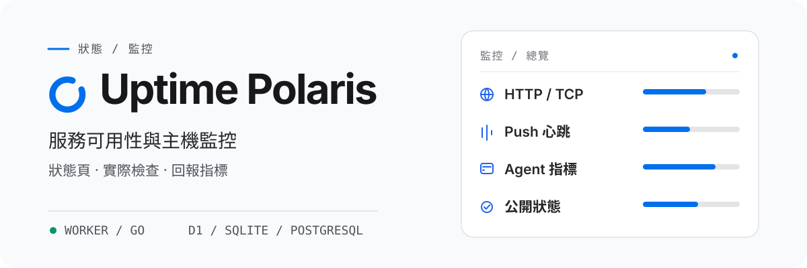

<h1 align="center">
  <picture>
    <source media="(prefers-color-scheme: dark)" srcset="assets/readme/overview-zh-TW-dark.svg">
    <source media="(prefers-color-scheme: light)" srcset="assets/readme/overview-zh-TW-light.svg">
    
  </picture>
</h1>

<p align="center"><strong>HTTP/TCP 檢查、Push 心跳、主機指標</strong><br>可執行於 Cloudflare Worker 或自行託管的 Go 後端。</p>

<p align="center">
  <a href="README.md">English</a> · <a href="README-zh-CN.md">简体中文</a> · <strong>繁體中文（台灣）</strong> · <a href="README-zh-HK.md">繁體中文（香港）</a> · <a href="README-ja-JP.md">日本語</a> · <a href="README-ko-KR.md">한국어</a> · <a href="README-fr-FR.md">Français</a> · <a href="README-pt-BR.md">Português (Brasil)</a> · <a href="README-ru-RU.md">Русский</a>
</p>

<p align="center">
  <a href="https://developers.cloudflare.com/workers/"></a>
  <a href="backends/go/README.md"></a>
  <a href="frontend/README.md"></a>
  <a href="https://github.com/XingLingQAQ/polaris-agent"></a>
  <a href="docs/configuration.md"></a>
</p>

<p align="center">
  <a href="#快速開始">快速開始</a> ·
  <a href="#部署到-cloudflare">部署</a> · <a href="#deploy-go">部署 Go</a> ·
  <a href="#監控主機">Agent</a> ·
  <a href="#文件">文件</a>
</p>

Uptime Polaris 定時檢查網站和連接埠，接收定時任務傳送的心跳，採集伺服器的 CPU、記憶體和磁碟指標，並在監控狀態變化時發送通知。專案內建公開狀態頁和管理後台。

## 選擇後端

每次部署選擇一種後端，兩種後端使用相同的介面。

| | Cloudflare Worker | Go |
| --- | --- | --- |
| 執行環境 | Cloudflare | 自有伺服器或容器 |
| 資料庫 | D1 或 PostgreSQL | SQLite 或 PostgreSQL |
| 直接探測 | HTTP、TCP（UDP、ICMP 需透過 Agent） | HTTP、TCP、UDP、ICMP、DNS、TLS、WebSocket |
| 最短檢查間隔 | 60 秒 | 5 秒 |
| 主題檔案 | R2（選用） | 資料目錄 |

不想維護伺服器時建議使用 Worker；需要探測內網服務、使用更多協定或更短的檢查間隔時，請選擇 Go。詳細比較見[選擇後端](docs/backends.md)。

## 功能

<p align="center">
  <br>
  <strong>服務檢查與心跳</strong><br>
  支援 HTTP 和 TCP 檢查，並可附加回應內容、憑證、網域到期和 DNS 檢查。Push 監控適用於定時任務和備份腳本，超過設定時間未收到心跳即判定為異常。
</p>

<p align="center">
  <br>
  <strong>伺服器監控</strong><br>
  <code>polaris-agent</code> 上報 CPU、記憶體、磁碟、負載和網路指標，也可以從所在主機發起 HTTP/TCP 檢查，用於探測內網服務。
</p>

<p align="center">
  <br>
  <strong>狀態頁與通知</strong><br>
  狀態頁展示目前狀態和事件歷史，支援分組和維護視窗。通知管道包括 Telegram、飛書、Slack、Discord、Webhook、Apprise 和 Server醬，每個管道可以限定負責的監控分組。
</p>

<p align="center">
  <br>
  <strong>儲存與主題</strong><br>
  Worker 使用 D1 或 PostgreSQL 儲存資料，主題存放在 R2；Go 使用 SQLite 或 PostgreSQL，主題存放在資料目錄。
</p>

## 快速開始

1. 將服務部署到 [Cloudflare](#部署到-cloudflare) 或[自有伺服器](#deploy-go)。
2. 開啟站點的 `/setup` 頁面。Worker 會先檢查綁定和密鑰，通過後輸入 `ADMIN_TOKEN`；Go 輸入啟動日誌中的初始化密鑰。
3. 建立管理員帳號，然後在 `/admin` 新增監控。

## 部署到 Cloudflare

1. Fork 本儲存庫。
2. 在 Cloudflare 控制台開啟 **Workers & Pages → Create application → GitHub**，選擇 fork 後的儲存庫。建置命令填寫 `npm run build`，部署命令填寫 `npm run deploy`。
3. 部署完成後開啟站點，初始化頁面會先檢查綁定和密鑰。請依頁面提示在 Worker 的 **Settings** 中設定：
   - **資料庫（二選一）**：用 D1 時在 **Bindings** 中新增資料庫，變數名稱填 `DB`；用 PostgreSQL 時在 **Variables and Secrets** 中新增 Secret `DATABASE_URL`，未綁定 D1 時會自動按 PostgreSQL 處理。
   - **初始化金鑰**：在 **Variables and Secrets** 中新增 Secret `ADMIN_TOKEN`，值使用足夠長的隨機字串，例如 `openssl rand -hex 32` 的輸出。
   - **選用**：安裝第三方主題時新增 R2 儲存桶（變數名稱 `THEMES`）；需要原始觀測與回填時，在啟用 Analytics Engine 後新增資料集（變數名稱 `UPTIME`）。
4. 在初始化頁面點擊「重新檢查」，通過後進入下一步，輸入 `ADMIN_TOKEN` 建立管理員帳號。

後續升級只需在 GitHub 上執行 Sync fork，Workers Builds 會自動重新部署，並保留控制台中已新增的綁定。

也可以透過下方按鈕部署。按鈕部署會在你的 GitHub 帳號下建立新儲存庫（不是 fork，後續無法透過 Sync fork 同步更新），資料庫和密鑰同樣依初始化頁面的提示設定：

[](https://deploy.workers.cloudflare.com/?url=https://github.com/XingLingQAQ/UptimePolaris)

命令列部署與 PostgreSQL 設定見[部署指南](docs/deployment.md)。

<a id="deploy-go"></a>

## 部署 Go 後端

從 [Releases](https://github.com/XingLingQAQ/UptimePolaris/releases) 下載對應系統和架構的程式，重新命名為 `polaris`（Windows 為 `polaris.exe`）後啟動：

```sh
chmod +x polaris   # Linux / macOS
./polaris --data-dir ./data
```

```powershell
.\polaris.exe --data-dir .\data
```

程式預設監聽 `127.0.0.1:8080`。如需對外存取，請修改 `--addr` 或設定反向代理。所有資料保存在 `./data` 目錄，該目錄需要持久化儲存、限制存取權限並定期備份。更多設定見 [Go 後端說明](backends/go/README.md#安裝與啟動)。

## 監控主機

在後台的 Agent 頁面新增機器，選擇平台和安裝方式，然後在目標機器上執行產生的安裝命令。目標機器需要能夠存取 GitHub。

安裝完成後，可使用 `pa`（`polaris-agent` 的簡寫）管理服務：

```sh
pa status
pa restart
pa logs -f
```

- 安裝命令包含站點位址和該機器的 Token，請在正式網域下產生，並避免公開。
- 新增機器不會自動建立監控，需要在監控頁面新增 Agent 類型的監控。
- 手動安裝模式沒有服務管理器，`pa start`、`stop`、`restart` 無法使用。

更多說明見 [Agent 手冊](docs/agents.md)。

## 使用與公開資訊

狀態頁無需登入即可存取，監控名稱、目標路徑和主機名稱可能出現在公開頁面和公開介面中，請勿在其中填寫內網位址或密鑰。公開範圍詳見[公開資料](docs/usage.md#公开数据)，通知設定見[通知指南](docs/notifications.md)。

## 文件

| 文件 | 內容 |
| --- | --- |
| [選擇後端](docs/backends.md) | Worker 與 Go 的差異 |
| [部署指南](docs/deployment.md) | Fork 部署、按鈕部署、手動部署、網域、PostgreSQL、D1 遷移到 PostgreSQL |
| [Go 後端](backends/go/README.md) | 啟動參數、環境變數、SQLite 遷移到 PostgreSQL |
| [使用手冊](docs/usage.md) | 監控設定、Push、狀態與可用率 |
| [Agent 手冊](docs/agents.md) | 安裝、管理、設定、更新、解除安裝 |
| [通知指南](docs/notifications.md) | 管道設定、分組範圍、投遞記錄 |
| [主題指南](docs/themes.md) | 安裝、設定、預覽 |
| [設定參考](docs/configuration.md) | 綁定、環境變數、後台設定 |
| [API 參考](docs/api.md) | 介面、認證、範例 |
| [維運指南](docs/operations.md) | 備份、還原、升級、資料保留 |
| [常見問題](docs/troubleshooting.md) | 依故障現象排查 |

## 授權

本專案採用 [MIT 授權](LICENSE)。
