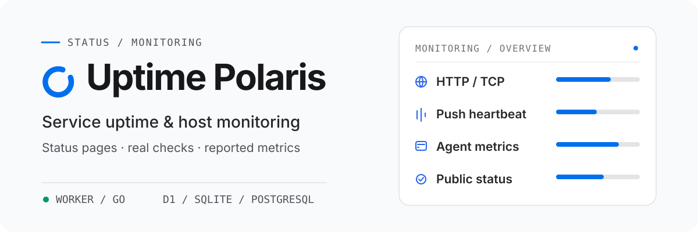

<h1 align="center">
  <picture>
    <source media="(prefers-color-scheme: dark)" srcset="assets/readme/overview-dark.svg">
    <source media="(prefers-color-scheme: light)" srcset="assets/readme/overview-light.svg">
    
  </picture>
</h1>

<p align="center"><strong>HTTP/TCP checks, Push heartbeats, host metrics</strong><br>Runs on Cloudflare Workers or a self-hosted Go server.</p>

<p align="center">
  <strong>English</strong> · <a href="README-zh-CN.md">简体中文</a> · <a href="README-zh-TW.md">繁體中文（台灣）</a> · <a href="README-zh-HK.md">繁體中文（香港）</a> · <a href="README-ja-JP.md">日本語</a> · <a href="README-ko-KR.md">한국어</a> · <a href="README-fr-FR.md">Français</a> · <a href="README-pt-BR.md">Português (Brasil)</a> · <a href="README-ru-RU.md">Русский</a>
</p>

<p align="center">
  <a href="https://developers.cloudflare.com/workers/"></a>
  <a href="backends/go/README.md"></a>
  <a href="frontend/README.md"></a>
  <a href="https://github.com/XingLingQAQ/polaris-agent"></a>
  <a href="docs/configuration.md"></a>
</p>

<p align="center">
  <a href="#quick-start">Quick start</a> ·
  <a href="#deploy-to-cloudflare">Deploy</a> · <a href="#deploy-go">Go deployment</a> ·
  <a href="#monitor-hosts">Agent</a> ·
  <a href="#documentation">Documentation</a>
</p>

Uptime Polaris provides a public status page, an admin console, and scheduled monitoring in one application. It runs HTTP and TCP checks, receives Push heartbeats, collects host metrics through `polaris-agent`, and sends notifications when a monitor changes state.

## What it does

<p align="center">
  <br>
  <strong>Service checks and heartbeats</strong><br>
  HTTP and TCP checks, plus response, certificate, domain, and DNS assertions. Push monitors accept heartbeats from scheduled jobs and do not measure latency.
</p>

<p align="center">
  <br>
  <strong>Host metrics and probes</strong><br>
  <code>polaris-agent</code> reports CPU, memory, disk, and network metrics. It can also run HTTP and TCP checks from the host.
</p>

<p align="center">
  <br>
  <strong>Status page and notifications</strong><br>
  The public page shows current state and event history. Groups, maintenance windows, and channels decide what is shown and who is notified.
</p>

<p align="center">
  <br>
  <strong>Storage and themes</strong><br>
  Worker stores data in D1 or PostgreSQL and theme assets in R2. Go uses SQLite or PostgreSQL and keeps themes in its data directory.
</p>

## Choose a backend

Pick one backend per deployment. Go runs without a Cloudflare account, D1, or R2.

Both backends serve the same frontend and admin interface.

| | Cloudflare Worker | Go backend |
| --- | --- | --- |
| Run on | Cloudflare | Your server or container |
| Database | D1 / PostgreSQL | SQLite / PostgreSQL |
| Native probes | HTTP / TCP | HTTP / TCP / UDP / ICMP / DNS / TLS / WebSocket |
| Agent probes | Supported | Supported |
| Theme assets | Optional R2 bucket | Data directory |
| Minimum interval | 60 seconds | 5 seconds |

Worker cannot run native UDP, ICMP, DNS, TLS, or WebSocket probes; it can use an online Agent for UDP and ICMP. Go runs those protocols directly, and ICMP only when the process can open raw sockets. The console offers the probe types supported by the active backend and by online Agents.

See [backend options](docs/backends.md#english) and the [Go backend guide](backends/go/README.md#english).

## Quick start

Pick a backend and follow its deployment guide. Open `/setup`, create an admin account, and add the first monitor at `/admin`.

### Cloudflare Worker

[Deploy to Cloudflare](#deploy-to-cloudflare)

### Go

The Go executable includes the web interface. Download the build for your system from Releases, then follow the [Go guide](backends/go/README.md#english).

## Deploy to Cloudflare

[](https://deploy.workers.cloudflare.com/?url=https://github.com/XingLingQAQ/UptimePolaris)

The button forks the repository and starts the deployment. Enter new names for the Worker and database, and set `ADMIN_TOKEN` to a long random value as a Worker Secret. If the database ID is missing, find or create the D1 database in Cloudflare, replace the `database_id` placeholder in the forked `wrangler.jsonc`, and deploy again. The [deployment guide](docs/deployment.md#deploy-with-the-cloudflare-button) lists the exact steps.

The button template binds D1, static assets, and schedules. R2 themes and Analytics Engine are not included. Agent installation needs access to GitHub release downloads.

<a id="deploy-go"></a>

## Deploy the Go backend

Download the build for your system from [Releases](https://github.com/XingLingQAQ/UptimePolaris/releases), then follow the [Go installation guide](backends/go/README.md#install-and-start). The binary includes the web interface. Keep the data directory persistent, restrict access to it, and back up the database with the rest of the directory.

## Monitor hosts

Create a machine on the console's Agent page, choose a platform and installation mode, then run the generated command on the target machine. The installer downloads the latest stable release for that platform.

The installer registers the `polaris-agent` service and the `pa` command. Both operate the same program, configuration, and service:

```sh
pa status
pa restart
pa logs -f
```

`pa start`, `stop`, and `restart` need a service manager; manual installations run in the foreground instead. `pa logs` reads the installation's log file. Installation commands contain the scheme, domain, and port of the current site, so generate them from the address you intend to keep. Installation modes, platform limits, configuration, updates, and removal are in the [Agent guide](docs/agents.md).

## Usage and public information

The public status page is anonymous. Before adding a monitor, confirm that its name, target path, hostname, and any internal addresses contain nothing sensitive. Public endpoints remove authentication data; they do not inspect names or paths for sensitive content. See [public data](docs/usage.md#maintenance-status-and-public-data).

Notification channels are Telegram, Feishu, Slack, Discord, Webhook, Apprise, and ServerChan. A channel can be limited to monitor groups. Setup and delivery troubleshooting are in the [notification guide](docs/notifications.md).

## Documentation

| Task | Guide |
| --- | --- |
| Deploy a site, configure a domain, or use PostgreSQL | [Deployment](docs/deployment.md) |
| Compare backends | [Worker / Go](docs/backends.md#english) · [Go](backends/go/README.md#english) |
| Create monitors and read status or public data | [Usage](docs/usage.md) |
| Install and manage host Agents | [Agent](docs/agents.md) |
| Configure bindings, environment variables, and console settings | [Configuration reference](docs/configuration.md) |
| Set up notification channels and scope | [Notifications](docs/notifications.md) |
| Install or configure status-page themes | [Themes](docs/themes.md) |
| Call the API or send Push heartbeats | [API reference](docs/api.md) |
| Back up, upgrade, and troubleshoot | [Operations](docs/operations.md) · [Troubleshooting](docs/troubleshooting.md) |

Full index: [docs/README.md](docs/README.md). The usage, operations, and troubleshooting guides include English summaries.

## License

This project is licensed under the [MIT License](LICENSE).
